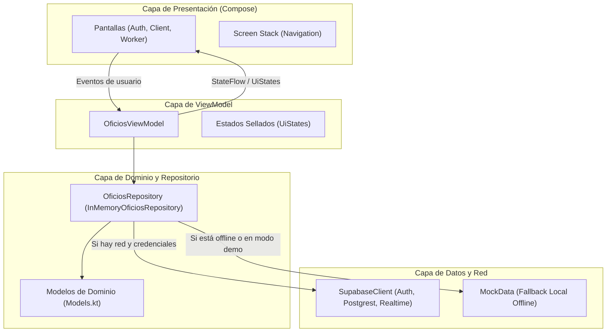
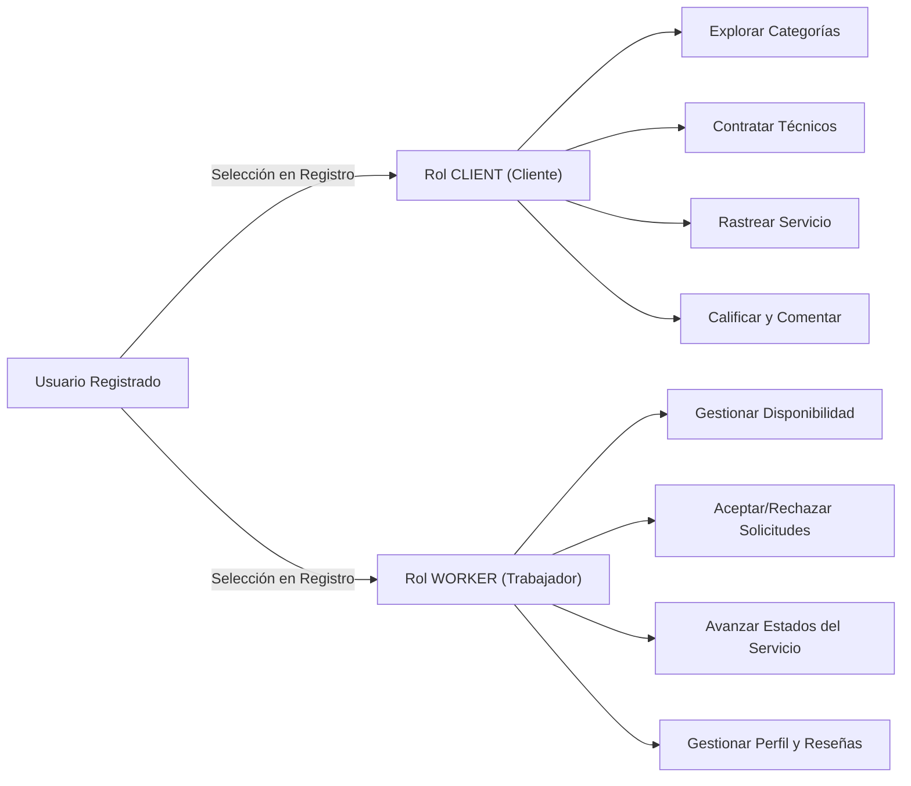

<div align="center">

# 🛠️ OficiosCerca

### Plataforma Móvil para la Conexión, Contratación y Seguimiento de Servicios del Hogar

# OficiosCerca-App
Aplicación móvil para conectar clientes con trabajadores independientes de servicios para el hogar.

[](https://developer.android.com/)
[](https://kotlinlang.org/)
[](https://developer.android.com/jetpack/compose)
[](https://supabase.com/)
[](https://gradle.org/)
[](docs/ARCHITECTURE.md)

</div>

---

## 📌 1. Descripción Profesional

**OficiosCerca** es una solución móvil nativa para Android diseñada para tender un puente seguro, confiable y eficiente entre personas que necesitan resolver emergencias o tareas de mantenimiento en su hogar y trabajadores técnicos independientes calificados (plomeros, electricistas, carpinteros, pintores, cerrajeros y técnicos de electrodomésticos).

La plataforma permite a los usuarios descubrir profesionales geolocalizados en su comunidad, evaluar su trayectoria mediante calificaciones y reseñas reales, solicitar servicios con fechas y descripciones detalladas, monitorear el estado del trabajo en tiempo real y calificar la experiencia al finalizar. Para los trabajadores independientes, representa una oficina virtual para captar clientes, gestionar su disponibilidad y administrar el ciclo de vida de sus servicios.

---

## 🔍 2. Contexto y Problemática

En los entornos urbanos modernos, la contratación de servicios de oficio para el hogar presenta fricciones estructurales recurrentes:
1. **Falta de Confianza y Verificación:** Para un usuario es difícil evaluar la reputación, idoneidad y antecedentes de un técnico desconocido antes de permitirle el ingreso a su domicilio.
2. **Informalidad e Incertidumbre:** La mayoría de estos servicios se contratan por canales informales (boca a boca o avisos clasificados), lo que genera opacidad en precios, falta de trazabilidad en los acuerdos y tiempos de llegada impredecibles.
3. **Brecha Digital para el Trabajador Independiente:** Los maestros y técnicos de oficios tradicionales suelen carecer de canales digitales estructurados para dar a conocer sus servicios, organizar su agenda y construir una reputación verificable que potencie su actividad laboral.

---

## 💡 3. Justificación

OficiosCerca aborda esta problemática mediante una aplicación móvil nativa con estándares modernos de ingeniería de software:
- Centraliza la oferta y la demanda en un entorno transparente con calificaciones y reseñas auditadas.
- Brinda certidumbre al usuario a través de una máquina de estados estricta que informa si el profesional aceptó la solicitud, si va en camino, si está laborando o si ha finalizado.
- Otorga dignidad e identidad profesional al trabajador, permitiéndole gestionar su perfil, experiencia y disponibilidad desde su propio teléfono celular.
- Implementa una arquitectura resiliente con capacidad de operación offline o en modo demostración, asegurando que la experiencia sea fluida incluso ante contingencias de red.

---

## 🎯 4. Objetivos del Proyecto

### 4.1 Objetivo General
Desarrollar y documentar una aplicación móvil nativa para Android en Kotlin y Jetpack Compose que implemente una arquitectura escalable MVVM con backend en Supabase, facilitando el descubrimiento, contratación, gestión en vivo y evaluación de servicios técnicos para el hogar.

### 4.2 Objetivos Específicos
- Diseñar e implementar una interfaz de usuario 100% declarativa y responsiva mediante **Jetpack Compose (Material 3)**.
- Integrar autenticación de usuarios basada en roles (`CLIENT` y `WORKER`) con persistencia en la nube mediante **Supabase Auth**.
- Modelar e implementar un esquema de base de datos relacional en **PostgreSQL (Supabase)** para categorías, profesionales, solicitudes, reseñas y notificaciones.
- Desarrollar una máquina de estados secuencial para el seguimiento de solicitudes (`pending` → `accepted` → `on_the_way` → `in_progress` → `completed`).
- Proveer un mecanismo de respaldo local (**MockData**) que garantice la ejecución, auditoría y pruebas del proyecto sin depender obligatoriamente de conexión externa.

---

## 🚀 5. Funcionalidades Principales

### 👤 Para Clientes:
- **Directorio de Oficios y Profesionales:** Exploración por categorías oficiales (Plomería, Electricidad, Carpintería, Pintura, Cerrajería, Electrodomésticos).
- **Búsqueda y Filtros en Tiempo Real:** Filtro reactivo por nombre, especialidad y zona.
- **Vista de Mapa Interactiva:** Visualización de profesionales cercanos geolocalizados en el área metropolitana de Medellín.
- **Perfil Profesional Detallado:** Consulta de años de experiencia, biografía, servicios específicos, disponibilidad y reseñas de clientes anteriores.
- **Contratación en 3 Pasos:** Formulario de descripción del problema, selección de fecha y franja horaria, resumen de confirmación y pantalla de éxito.
- **Seguimiento Paso a Paso (Live Tracking):** Indicador visual de 4 fases del estado del servicio con opción de llamada directa y cancelación segura.
- **Sistema de Evaluación:** Calificación de 1 a 5 estrellas y reseña escrita que actualiza la reputación del trabajador.
- **Historial Completo:** Consulta cronológica de solicitudes activas y finalizadas.

### 👷 Para Trabajadores / Profesionales:
- **Panel de Control (Dashboard):** Métricas de solicitudes pendientes, trabajos activos, historial completado y promedio de calificación.
- **Gestión de Disponibilidad:** Interruptor (toggle) para alternar entre "Disponible" y "No disponible" ante nuevos clientes.
- **Bandeja de Solicitudes:** Aprobación o rechazo directo de trabajos entrantes con información de contacto y ubicación del cliente.
- **Gestión del Servicio Activo:** Avance secuencial del estado del trabajo ("Voy en camino", "Iniciar trabajo", "Finalizar servicio").
- **Edición de Perfil Profesional:** Modificación de oficio, años de experiencia, descripción y datos de contacto.
- **Historial de Reseñas:** Consulta de valoraciones y retroalimentación dejada por la comunidad.

### 🔐 Seguridad y Sistema:
- **Autenticación GoTrue:** Registro con validación en dos fases, inicio de sesión y recuperación de contraseña vía correo electrónico.
- **Autoreparación de Perfiles (Self-Healing):** Mecanismo de sincronización que restaura registros de base de datos a partir de los metadatos de sesión JWT.
- **Centro de Notificaciones:** Notificaciones internas de cambios de estado y recordatorios.

---

## 💻 6. Tecnologías Utilizadas

| Capa / Componente | Tecnología | Versión |
| :--- | :--- | :--- |
| **Lenguaje de Programación** | Kotlin | `2.2.10` (Java 11 Target) |
| **Framework de UI** | Jetpack Compose (Compose BOM) | `2024.09.00` |
| **Diseño / Sistema de Diseño** | Material 3 & Material Icons Extended | Oficial de Google |
| **Arquitectura** | MVVM + Repository Pattern + UDF | Jetpack Lifecycle `2.8.7` |
| **Asincronía y Flujos** | Kotlin Coroutines & StateFlow | `1.10.2` |
| **Build Tool** | Gradle Wrapper & Android Gradle Plugin | Gradle `9.3.1` / AGP `9.1.1` |
| **Backend & Base de Datos** | Supabase (PostgreSQL + Auth + PostgREST) | Supabase BOM `3.2.6` |
| **Cliente HTTP / Motor** | Ktor Client | `3.3.1` |
| **Serialización** | Kotlinx Serialization (JSON) | `2.2.10` |
| **Gestión de Secretos** | Secrets Gradle Plugin | `2.0.1` |
| **Testing** | JUnit 4, Robolectric, Compose UI Test | Robolectric `4.16.1`, JUnit `4.13.2` |

---

## 🏛️ 7. Arquitectura del Software

El proyecto sigue una arquitectura desacoplada basada en el flujo unidireccional de datos (**Unidirectional Data Flow - UDF**):



Para una explicación exhaustiva de la arquitectura, revisa el documento dedicado:
📖 **[docs/ARCHITECTURE.md](docs/ARCHITECTURE.md)**

---

## 👥 8. Roles de Usuario



---

## 📸 9. Capturas de Pantalla

*(Sección preparada para la inclusión de capturas de pantalla de la aplicación en ejecución)*

| Inicio de Sesión | Selección de Rol | Pantalla Principal Cliente |
| :---: | :---: | :---: |
| *(Captura: Pantalla de Login)* | *(Captura: Selección de Rol y Oficio)* | *(Captura: Home con Categorías)* |

| Detalle del Profesional | Solicitud y Confirmación | Seguimiento en Vivo |
| :---: | :---: | :---: |
| *(Captura: Perfil y Reseñas)* | *(Captura: Formulario de Solicitud)* | *(Captura: Live Tracking de 4 fases)* |

| Panel del Trabajador | Gestión de Solicitud Activa | Calificación y Reseña |
| :---: | :---: | :---: |
| *(Captura: Métricas y Toggle)* | *(Captura: Avance de Estados)* | *(Captura: Selector de Estrellas)* |

---

## 📂 10. Estructura del Repositorio

```
oficioscerca/
├── app/                    # Módulo principal de la aplicación Android
│   ├── src/main/java/      # Código fuente Kotlin (MainActivity, model, service, ui, viewmodel)
│   ├── src/main/res/       # Recursos gráficos, valores, temas y drawables
│   ├── src/test/           # Pruebas unitarias y con Robolectric
│   └── build.gradle.kts    # Configuración de compilación y dependencias del módulo
├── docs/                   # Documentación técnica completa
│   ├── ARCHITECTURE.md     # Detalle arquitectónico y diagramas
│   ├── DATABASE.md         # Esquema de Supabase / PostgreSQL y RLS
│   ├── FUNCTIONALITIES.md  # Catálogo de funcionalidades y casos de uso
│   ├── INSTALLATION.md     # Guía de instalación y compilación paso a paso
│   ├── PROJECT_STRUCTURE.md# Descripción detallada de carpetas y archivos
│   ├── CONTRIBUTING.md     # Guía para colaboradores
│   └── SECURITY.md         # Políticas de seguridad y gestión de secretos
├── gradle/                 # Version Catalog (libs.versions.toml) y Gradle Wrapper
├── .env.example            # Plantilla de variables de entorno
├── .gitignore              # Reglas maestras de exclusión para Git
├── .gitattributes         # Normalización de fin de línea
├── CHANGELOG.md            # Historial de versiones y cambios
├── CONTRIBUTING.md         # Portal raíz de contribución
├── LICENSE                 # Estado y propuesta de licencia
└── README.md               # Este documento
```

---

## ⚙️ 11. Requisitos e Instalación

### Requisitos Previos:
- **Android Studio:** Ladybug (2024.2.1) o superior.
- **JDK:** Java 17 o Java 21 configurado en Android Studio.
- **Android SDK:** API 36 (`minSdk = 24`, `targetSdk = 36`).
- **Git:** 2.30 o superior.

### Pasos Rápidos de Ejecución:

1. **Clonar el repositorio:**
   ```bash
   git clone https://github.com/<tu-usuario>/oficioscerca.git
   cd oficioscerca
   ```

2. **Configurar variables de entorno:**
   Copia el archivo `.env.example` como `.env`:
   ```bash
   cp .env.example .env
   ```
   *(Si deseas usar la nube, ingresa tus claves de Supabase. Si deseas probar la app localmente, no modifiques nada; operará en modo demo automático).*

3. **Abrir en Android Studio y sincronizar:**
   Abre el proyecto en Android Studio y haz clic en **Sync Project with Gradle Files**.

4. **Compilar y Ejecutar:**
   Selecciona un emulador con API 34 o superior y presiona **Run 'app' (Shift + F10)**, o compila por consola:
   ```bash
   ./gradlew assembleDebug
   ```

Para una guía detallada con solución de problemas frecuentes, consulta:
📖 **[docs/INSTALLATION.md](docs/INSTALLATION.md)**

---

## 🗄️ 12. Conexión con Supabase

OficiosCerca utiliza un esquema relacional de 7 tablas en PostgreSQL sobre Supabase:
- `profiles`: Datos de usuario, nombres, teléfono, rol y ubicación.
- `categories`: Catálogo maestro de oficios (Plomería, Electricidad, Carpintería, etc.).
- `professionals`: Información profesional de trabajadores (oficio, años de experiencia, calificación promedio).
- `professional_services`: Relación de servicios específicos vinculados a cada profesional.
- `service_requests`: Solicitudes de trabajo entre clientes y trabajadores con máquina de estados.
- `reviews`: Calificaciones numéricas (1 a 5) y comentarios de clientes.
- `notifications`: Sistema interno de notificaciones para los usuarios.

Para ver el diagrama entidad-relación y las políticas de seguridad RLS, revisa:
📖 **[docs/DATABASE.md](docs/DATABASE.md)**

---

## 🔒 13. Seguridad y Protección de Secretos

- Las credenciales privadas (`SUPABASE_URL`, `SUPABASE_PUBLISHABLE_KEY`) nunca se guardan en el código fuente. Se inyectan mediante el plugin Secrets Gradle Plugin y el archivo `.env` está estrictamente excluido en `.gitignore`.
- Se implementan principios de mínima exposición y revocación de sesión en dos niveles (global y local).

Para consultar la auditoría de seguridad y políticas de reporte, consulta:
📖 **[docs/SECURITY.md](docs/SECURITY.md)**

---

## 🤝 14. Contribución y Buenas Prácticas

Invitamos a la comunidad académica y de desarrollo a proponer mejoras y extensiones para OficiosCerca:
- Utiliza la plantilla de incidencias en [.github/ISSUE_TEMPLATE/](.github/ISSUE_TEMPLATE/).
- Envía tus aportes mediante Pull Requests utilizando [.github/PULL_REQUEST_TEMPLATE.md](.github/PULL_REQUEST_TEMPLATE.md).
- Sigue las convenciones detalladas en [docs/CONTRIBUTING.md](docs/CONTRIBUTING.md).

---

## 👨‍💻 15. Autores y Créditos

Este proyecto ha sido desarrollado como una solución integral de software móvil con estándares de ingeniería de software para plataformas Android modernas.

- **Diseño y Desarrollo de Software:** Equipo del Proyecto OficiosCerca.
- **Herramientas de Ecosistema:** Google Android, Jetpack Compose, Kotlin, Supabase.

---

## 📄 16. Licencia

El estado legal y licenciamiento definitivo de este proyecto se encuentra en proceso de definición por parte de sus autores. Para revisar las recomendaciones preliminares (Licencia MIT o Apache 2.0), consulta el archivo [LICENSE](LICENSE).

---

<div align="center">
<b>OficiosCerca — Conectando la confianza de tu hogar con los mejores oficios.</b>
</div>


