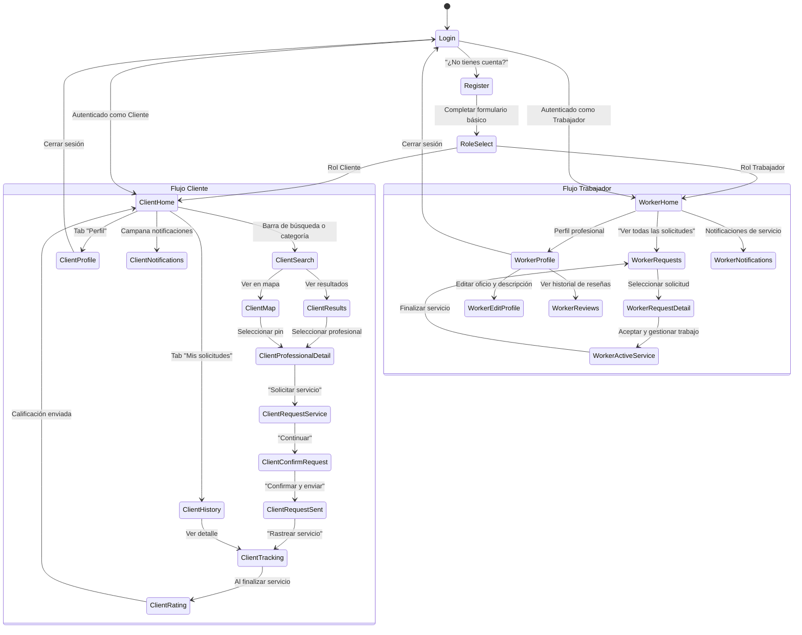
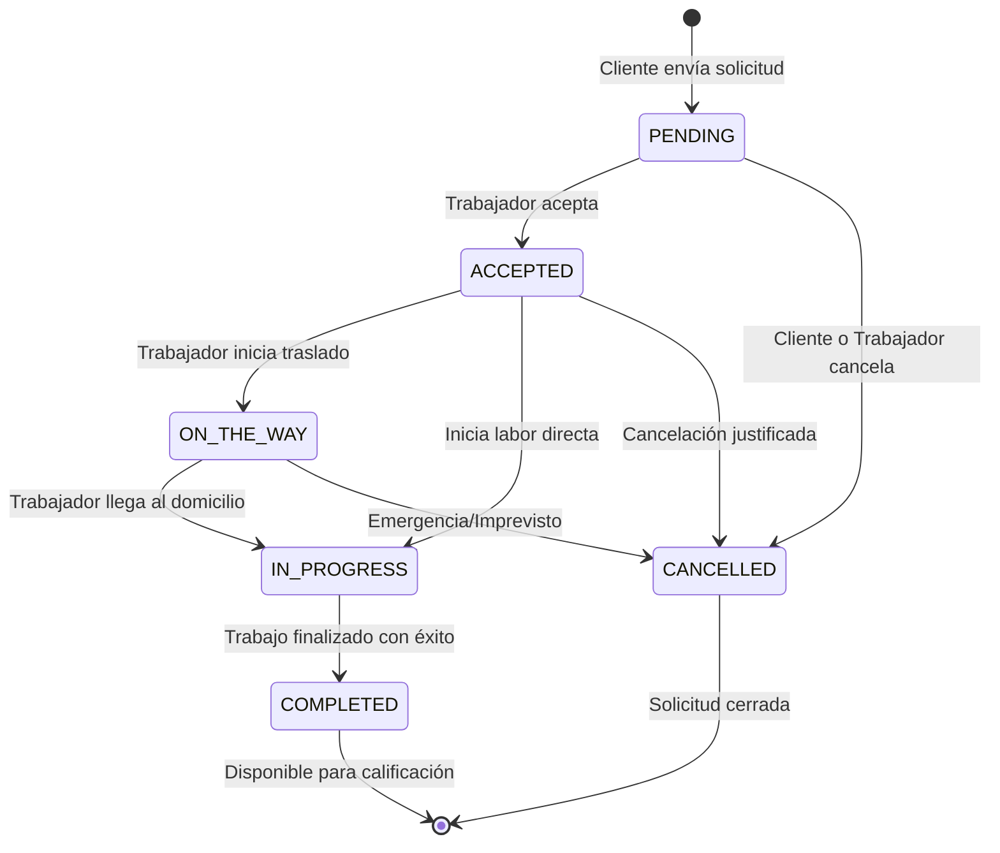

# Arquitectura de Software — OficiosCerca

Este documento describe en profundidad la arquitectura de software, patrones de diseño, componentes técnicos y flujos de datos de la aplicación móvil **OficiosCerca**.

---

## 1. Visión General de la Arquitectura

OficiosCerca está desarrollada siguiendo una **arquitectura moderna para Android recomendada por Google**, implementando el patrón **Model-View-ViewModel (MVVM)** junto con el patrón **Repository**, programación reactiva basada en flujos (**Kotlin Coroutines & StateFlow**) y una interfaz de usuario 100% declarativa construida con **Jetpack Compose**.

La arquitectura está estructurada en capas claramente desacopladas:

```mermaid
graph TD
    subgraph UI_Layer["Capa de Presentación (UI Layer)"]
        Activity["MainActivity (Single Activity)"]
        NavHost["Gestor de Navegación por Estado (Screen)"]
        Screens["Composables (Auth, Client, Worker)"]
        Components["Componentes Reutilizables (CommonComponents)"]
    end

    subgraph ViewModel_Layer["Capa de Estado y Lógica (ViewModel Layer)"]
        VM["OficiosViewModel"]
        UiStates["Estados Sellados de UI (UiStates)"]
    end

    subgraph Domain_Repository_Layer["Capa de Dominio y Repositorio"]
        RepoInterface["OficiosRepository (Interface)"]
        RepoImpl["InMemoryOficiosRepository (Implementación Híbrida)"]
        DomainModels["Modelos de Dominio (Models.kt)"]
    end

    subgraph Data_Layer["Capa de Datos y Red (Data Layer)"]
        SupaClient["SupabaseClient (Singleton)"]
        AuthServ["AuthService (GoTrue / Auth)"]
        Postgrest["PostgREST (CRUD Cloud)"]
        MockDataSource["MockData (Fallback Local Offline)"]
    end

    Activity --> NavHost
    NavHost --> Screens
    Screens --> Components
    Screens -->|Eventos de usuario| VM
    VM -->|StateFlow / UiStates| Screens
    VM --> RepoInterface
    RepoInterface <|.. RepoImpl
    RepoImpl --> DomainModels
    RepoImpl --> SupaClient
    RepoImpl --> AuthServ
    RepoImpl --> Postgrest
    RepoImpl --> MockDataSource
```

---

## 2. Principios de Diseño Implementados

1. **Separación de Responsabilidades (SoC):** Cada clase tiene un único propósito definido. Las pantallas Compose no realizan consultas directas de red ni manipulan datos crudos; delegan todas las acciones al `OficiosViewModel`.
2. **Flujo Unidireccional de Datos (UDF - Unidirectional Data Flow):** 
   - El estado fluye hacia abajo desde el `OficiosViewModel` hacia las funciones composables a través de `StateFlow`.
   - Los eventos de usuario (clicks, texto, selección) fluyen hacia arriba desde las pantallas hacia el `OficiosViewModel` mediante llamadas a funciones.
3. **Resiliencia y Modo Híbrido (Offline-First Fallback):** La aplicación no colapsa si Supabase no está configurado o si no hay conexión a internet. El repositorio conmuta automáticamente a `MockData` para permitir pruebas locales, validación académica y ejecución en emuladores sin dependencias externas obligatorias.
4. **Single Activity:** Toda la navegación se ejecuta dentro de una única actividad (`MainActivity`), eliminando el costo de ciclo de vida entre múltiples Activities o Fragments.

---

## 3. Patrón MVVM en Detalle

### 3.1 Capa de Presentación (View)

La interfaz de usuario está construida íntegramente con **Jetpack Compose (Material 3)**. Se compone de pantallas especializadas agrupadas por dominio:

| Módulo | Pantallas / Componentes | Responsabilidad |
| :--- | :--- | :--- |
| **Raíz** | `MainActivity.kt`, `OficiosApp` | Punto de entrada, configuración de Edge-to-Edge, contenedor de Scaffold y BackHandler del sistema. |
| **Autenticación** | `LoginScreen`, `RegisterScreen`, `RoleSelectScreen`, `WelcomeScreen` | Registro en dos fases (credenciales + selección de rol/oficio), login con validación y modal de recuperación de clave. |
| **Cliente** | `ClientHomeScreen`, `ClientSearchScreen`, `ClientResultsScreen`, `ClientMapScreen`, `ClientProfessionalDetailScreen`, `ClientRequestServiceScreen`, `ClientConfirmRequestScreen`, `ClientRequestSentScreen`, `ClientTrackingScreen`, `ClientRatingScreen`, `ClientHistoryScreen`, `ClientProfileScreen`, `ClientNotificationsScreen` | Exploración de oficios, búsqueda y filtrado de trabajadores, detalle de profesional, contratación en 3 pasos, seguimiento en vivo, calificaciones e historial. |
| **Trabajador** | `WorkerHomeScreen`, `WorkerRequestsScreen`, `WorkerRequestDetailScreen`, `WorkerActiveServiceScreen`, `WorkerProfileScreen`, `WorkerEditProfileScreen`, `WorkerReviewsScreen` | Dashboard con métricas, disponibilidad (toggle), bandeja de solicitudes entrantes, cambio de estados del servicio, edición de perfil y listado de reseñas. |
| **Componentes Comunes** | `OficiosButton`, `OficiosOutlinedButton`, `UserAvatar`, `RatingStars`, `StatusBadge`, `EmptyStateView` | Bloques visuales reutilizables con soporte para tags de prueba automatizada (`testTag`). |

### 3.2 Capa de ViewModel

`OficiosViewModel` hereda de `androidx.lifecycle.ViewModel` y se encarga de:

- Mantener y emitir el estado de la aplicación mediante `StateFlow`.
- Orquestar la navegación interna mediante la jerarquía de rutas selladas `Screen`.
- Mantener la pila de navegación (`screenStack`) y responder al botón físico o gesto Atrás de Android.
- Administrar estados de carga, éxito y error específicos para cada acción crítica a través de interfaces selladas (`sealed interface`):
  - `ProfessionalDetailUiState`: `Loading`, `Success`, `Error`, `Empty`.
  - `CreateRequestUiState`: `Idle`, `Loading`, `Success`, `Error`.
  - `ClientRequestsUiState`: `Loading`, `Success`, `Error`.
  - `WorkerRequestsUiState`: `Loading`, `Success`, `Error`.
  - `WorkerActionUiState`: `Idle`, `Loading`, `Success`, `Error`.
  - `ProfileActionUiState`: `Idle`, `Loading`, `Success`, `Error`.
  - `ReviewActionUiState`: `Idle`, `Loading`, `Success`, `Error`.
  - `ClientActionUiState`: `Idle`, `Loading`, `Success`, `Error`.
- Combinar flujos reactivos mediante el operador `combine` (ej. filtrado de profesionales combinando `professionals`, `searchQuery` y `selectedCategoryFilter`).

### 3.3 Capa de Repositorio (Repository)

La interfaz `OficiosRepository` define el contrato para el acceso a datos. Su implementación concreta, `InMemoryOficiosRepository`, centraliza:

- Lectura y escritura en Supabase PostgREST cuando la conexión está activa (`SupabaseClient.isConfigured`) y existe un usuario con sesión iniciada.
- Fallback automático a colecciones en memoria alimentadas por `MockData` cuando el backend no está disponible o la aplicación se ejecuta en modo demo.
- Normalización de datos y resolución de relaciones entre tablas (ej. asociación de perfiles y categorías a solicitudes de servicio).
- Almacenamiento en memoria de calificaciones asociadas a solicitudes mediante un mapa concurrente seguro (`ConcurrentHashMap`).

---

## 4. Navegación por Estado (State-Driven Navigation)

En lugar de utilizar rutas basadas en cadenas de texto propensas a errores en tiempo de ejecución, el proyecto utiliza una jerarquía sellada `Screen`:

```kotlin
sealed class Screen(val route: String) {
    // Auth
    data object Welcome : Screen("welcome")
    data object Login : Screen("login")
    data object Register : Screen("register")
    data object RoleSelect : Screen("role_select")

    // Cliente
    data object ClientHome : Screen("client_home")
    data object ClientSearch : Screen("client_search")
    data object ClientResults : Screen("client_results")
    data object ClientMap : Screen("client_map")
    data object ClientProfessionalDetail : Screen("client_pro_detail")
    data object ClientRequestService : Screen("client_request_service")
    data object ClientConfirmRequest : Screen("client_confirm_request")
    data object ClientRequestSent : Screen("client_request_sent")
    data object ClientTracking : Screen("client_tracking")
    data object ClientRating : Screen("client_rating")
    data object ClientHistory : Screen("client_history")
    data object ClientProfile : Screen("client_profile")
    data object ClientNotifications : Screen("client_notifications")

    // Trabajador
    data object WorkerHome : Screen("worker_home")
    data object WorkerRequests : Screen("worker_requests")
    data object WorkerRequestDetail : Screen("worker_request_detail")
    data object WorkerActiveService : Screen("worker_active_service")
    data object WorkerProfile : Screen("worker_profile")
    data object WorkerEditProfile : Screen("worker_edit_profile")
    data object WorkerReviews : Screen("worker_reviews")
    data object WorkerNotifications : Screen("worker_notifications")
}
```

### Diagrama de Flujo de Navegación



---

## 5. Integración con Supabase y Flujo de Datos

La comunicación con el backend Supabase se realiza mediante el SDK oficial para Kotlin (`io.github.jan-tennert.supabase:bom:3.2.6`), configurado con los módulos de **Auth**, **Postgrest**, **Storage** y **Realtime**.

### Sanitización e Inicialización Perezosa

En `SupabaseClient.kt`, la URL del proyecto se normaliza antes de inicializar el cliente para evitar errores comunes causados por diagonales finales o subrutas agregadas por error (como `/rest/v1`):

```kotlin
object SupabaseClient {
    private val normalizedUrl: String by lazy {
        val raw = BuildConfig.SUPABASE_URL.trim()
        if (raw.isEmpty()) return@lazy ""
        val withoutSubpath = if (raw.contains("/rest/v1")) {
            raw.substringBefore("/rest/v1")
        } else {
            raw
        }
        withoutSubpath.trimEnd('/')
    }

    val isConfigured: Boolean
        get() = normalizedUrl.isNotEmpty() &&
                !normalizedUrl.startsWith("YOUR_") &&
                BuildConfig.SUPABASE_PUBLISHABLE_KEY.isNotBlank() &&
                !BuildConfig.SUPABASE_PUBLISHABLE_KEY.startsWith("YOUR_")

    val client by lazy {
        createSupabaseClient(
            supabaseUrl = normalizedUrl,
            supabaseKey = BuildConfig.SUPABASE_PUBLISHABLE_KEY.trim()
        ) {
            install(Auth)
            install(Postgrest)
            install(Storage)
            install(Realtime)
        }
    }
}
```

### Máquina de Estados del Servicio (`ServiceStatus`)

El ciclo de vida de una solicitud de servicio está protegido por reglas de transición validadas en el modelo de dominio:



---

## 6. Mecanismo de Autoreparación de Perfiles (Self-Healing)

Para evitar inconsistencias en las que un usuario logra registrarse en el sistema de autenticación de Supabase (`auth.users`) pero la inserción en la tabla pública `profiles` falla debido a interrupciones de red o políticas RLS, el repositorio implementa una estrategia de **autoreparación automática**:

1. Al iniciar sesión, `loadCurrentUserProfile()` consulta la tabla `profiles`.
2. Si el registro no existe, extrae los metadatos almacenados en el token JWT del usuario (`userMetadata["role"]`, `userMetadata["name"]`, `userMetadata["phone"]`).
3. Recrea automáticamente el registro en `profiles` con el rol y los datos correspondientes.
4. Si el rol es `WORKER`, asegura la existencia del registro vinculado en la tabla `professionals`.

---

## 7. Manejo de Dependencias y Modularidad

El proyecto centraliza todas sus dependencias en un catálogo de versiones (`gradle/libs.versions.toml`), facilitando el mantenimiento y garantizando la compatibilidad entre versiones de bibliotecas:

- **Kotlin:** 2.2.10
- **Android Gradle Plugin (AGP):** 9.1.1
- **Compose BOM:** 2024.09.00
- **Supabase BOM:** 3.2.6
- **Ktor:** 3.3.1
- **Robolectric:** 4.16.1

La inyección de claves de entorno se delega al plugin `secrets-gradle-plugin`, que lee los valores desde `.env` y los inyecta en la clase generada `BuildConfig` durante la compilación.

---

[← Volver al README](../README.md) | [Ver Estructura del Proyecto →](PROJECT_STRUCTURE.md)
