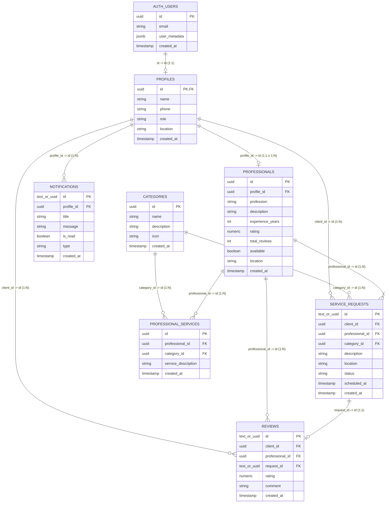

# Modelo de Base de Datos — OficiosCerca (Supabase / PostgreSQL)

Este documento detalla la estructura de la base de datos relacional de **OficiosCerca**, basada en **PostgreSQL** y alojada en **Supabase**. La información documentada proviene de una auditoría estricta de las consultas PostgREST, modelos de transferencia de datos (DTOs) y operaciones identificadas en el código fuente de la aplicación.

---

## 1. Diagrama Entidad-Relación (ERD)

A continuación se presenta el diagrama de entidades y relaciones identificadas en el código de la aplicación:



---

## 2. Tablas y Campos Identificados

### 2.1 Tabla `profiles`

Almacena la información de perfil público y rol de los usuarios registrados.

| Campo | Tipo en Código | Anotación SerialName / Columna BD | Restricciones / Observaciones |
| :--- | :--- | :--- | :--- |
| `id` | `String` (UUID) | `"id"` | **Primary Key**, vinculado directamente a `auth.users.id`. |
| `name` | `String?` | `"name"` | Nombre completo del usuario. En el código también se consideran variantes de compatibilidad como `full_name` o `nombre`. |
| `phone` | `String?` | `"phone"` | Número telefónico de contacto del usuario. |
| `role` | `String?` | `"role"` | Rol del usuario en el sistema. Valores admitidos: `'client'` o `'worker'`. |
| `location` | `String?` | `"location"` | Ciudad o zona residencial (ej. `"Medellín"`, `"Laureles"`). |
| `created_at` | `String?` | `"created_at"` | Marca de tiempo de creación del registro. |

> **Operaciones CRUD:**
> - **Create:** `upsert(profileDto)` durante el registro en `RoleSelectScreen`.
> - **Read:** Consulta con filtro por `id` (`eq("id", userId)`) o consulta masiva por lista de IDs (`isIn("id", missingProfileIds)`).
> - **Update:** Actualización de nombre, teléfono y ubicación en `updateClientProfile` y `updateWorkerProfile`.

---

### 2.2 Tabla `categories`

Catálogo maestro de oficios y servicios disponibles en la plataforma.

| Campo | Tipo en Código | Anotación SerialName / Columna BD | Restricciones / Observaciones |
| :--- | :--- | :--- | :--- |
| `id` | `String` (UUID) | `"id"` | **Primary Key**. Identificador único de categoría. |
| `name` | `String` | `"name"` | Nombre de la categoría (ej. `"Plomería"`, `"Electricidad"`). |
| `description` | `String?` | `"description"` | Breve descripción del alcance del oficio. |
| `icon` | `String?` | `"icon"` | Nombre clave del icono Material (ej. `"plumbing"`, `"bolt"`, `"handyman"`). |
| `created_at` | `String?` | `"created_at"` | Marca de tiempo de registro en el catálogo. |

#### Categorías Oficiales Identificadas en el Código:

| Categoría | UUID en Supabase | Oficio Asociado | Icono por Defecto |
| :--- | :--- | :--- | :--- |
| **Plomería** | `330571e3-9665-4088-92da-0f2c98d7f8f5` | Plomero | `plumbing` |
| **Electricidad** | `d09748d3-40d9-4775-affc-2c12bc6104a9` | Electricista | `bolt` / `electrical_services` |
| **Carpintería** | `df2f0a0d-8f97-45de-8656-3713b07cbfbc` | Carpintero | `carpenter` |
| **Pintura** | `199077e9-6042-4f9d-91bc-cb5f7095e903` | Pintor | `format_paint` |
| **Cerrajería** | `5933dda0-ea4d-4b9b-bb10-edd29e3225b0` | Cerrajero | `vpn_key` |
| **Electrodomésticos** | `7ba3598c-8314-43bd-9811-0738e2da3f71` | Técnico de electrodomésticos | `kitchen` |

> **Operaciones CRUD:**
> - **Read:** `select(columns = "id, name, description, icon, created_at")`. Consulta pública sin filtros requeridos.

---

### 2.3 Tabla `professionals`

Almacena los datos profesionales específicos de los usuarios que prestan servicios (trabajadores).

| Campo | Tipo en Código | Anotación SerialName / Columna BD | Restricciones / Observaciones |
| :--- | :--- | :--- | :--- |
| `id` | `String` (UUID) | `"id"` | **Primary Key**. Identificador del perfil profesional. |
| `profile_id` | `String` (UUID) | `"profile_id"` | **Foreign Key** que referencia a `profiles.id`. |
| `profession` | `String` | `"profession"` | Título u oficio del profesional (ej. `"Plomero certificado"`). |
| `description` | `String` | `"description"` | Descripción detallada de su experiencia y servicios. |
| `experience_years`| `Int` | `"experience_years"` | Años de experiencia en el oficio (mínimo 1 por defecto). |
| `rating` | `Double` | `"rating"` | Promedio de calificación acumulado (ej. `4.9`). |
| `total_reviews` | `Int` | `"total_reviews"` | Contador de reseñas / servicios completados. |
| `available` | `Boolean` | `"available"` | Estado de disponibilidad (`true` = activo, `false` = no disponible). |
| `location` | `String` | `"location"` | Ciudad o zona de cobertura principal (ej. `"Medellín"`). |
| `created_at` | `String?` | `"created_at"` | Fecha y hora de creación. |

> **Operaciones CRUD:**
> - **Create:** `insert(proInsert)` al registrarse como trabajador en `createProfessionalInSupabase`.
> - **Read:** `select` con joins embebidos a `profiles` y `professional_services`.
> - **Update:** Actualización de profesión, descripción, experiencia, disponibilidad y ubicación en `updateWorkerProfile`, así como actualización de `rating` y `total_reviews` al recibir reseñas.

---

### 2.4 Tabla `professional_services`

Tabla intermedia que vincula a un profesional con las categorías y descripciones específicas de servicios que ofrece.

| Campo | Tipo en Código | Anotación SerialName / Columna BD | Restricciones / Observaciones |
| :--- | :--- | :--- | :--- |
| `id` | `String` (UUID) | `"id"` | **Primary Key**. Identificador único de la vinculación. |
| `professional_id`| `String?` (UUID) | `"professional_id"` | **Foreign Key** a `professionals.id`. |
| `category_id` | `String?` (UUID) | `"category_id"` | **Foreign Key** a `categories.id`. |
| `service_description` | `String?` | `"service_description"` | Descripción puntual del servicio (ej. `"Reparación de fugas"`). |
| `created_at` | `String?` | `"created_at"` | Marca de tiempo de vinculación. |

> **Operaciones CRUD:**
> - **Create:** `insert(serviceInsert)` al asociar un oficio a un nuevo profesional.
> - **Read:** Obtenido mediante relaciones embebidas en la consulta de `professionals`.

---

### 2.5 Tabla `service_requests`

Registra las solicitudes de trabajo enviadas por los clientes a los profesionales.

| Campo | Tipo en Código | Anotación SerialName / Columna BD | Restricciones / Observaciones |
| :--- | :--- | :--- | :--- |
| `id` | `String?` | `"id"` | **Primary Key** (generado por Supabase o UUID local). |
| `client_id` | `String?` (UUID) | `"client_id"` | **Foreign Key** al usuario cliente (`profiles.id`). |
| `professional_id`| `String?` (UUID) | `"professional_id"` | **Foreign Key** al profesional asignado (`professionals.id`). |
| `category_id` | `String?` (UUID) | `"category_id"` | **Foreign Key** a la categoría del servicio (`categories.id`). |
| `description` | `String?` | `"description"` | Explicación detallada del problema o labor requerida. |
| `location` | `String?` | `"location"` | Dirección o sector donde se ejecutará el servicio. |
| `status` | `String?` | `"status"` | Estado de la solicitud (ver máquina de estados abajo). |
| `scheduled_at` | `String?` | `"scheduled_at"` | Fecha y hora programada o estimada. |
| `created_at` | `String?` | `"created_at"` | Fecha y hora de creación de la solicitud. |

#### Códigos de Estado (`status`):

| Código BD | Etiqueta UI | Significado |
| :--- | :--- | :--- |
| `'pending'` | Pendiente | Solicitud enviada por el cliente; esperando respuesta del trabajador. |
| `'accepted'` | Aceptada | El trabajador ha aceptado la solicitud. |
| `'on_the_way'`| En camino | El trabajador ha iniciado el viaje hacia el domicilio del cliente. |
| `'in_progress'`| En proceso | El trabajador está ejecutando la labor técnica. |
| `'completed'` | Finalizada | Trabajo concluido con éxito; pendiente de calificación. |
| `'cancelled'` | Cancelada | Solicitud cancelada por el cliente o rechazada por el trabajador. |

> **Operaciones CRUD:**
> - **Create:** `insert(dto) { select() }` en `createServiceRequest`.
> - **Read:** `select` con joins a `profiles`, `professionals` y `categories`, filtrando por `client_id` o `professional_id` y ordenado descendentemente por `created_at`.
> - **Update:** `update({ set("status", newStatus.code) })` para avanzar o cancelar el servicio.

---

### 2.6 Tabla `reviews`

Almacena las evaluaciones y comentarios emitidos por los clientes una vez que el servicio ha finalizado.

| Campo | Tipo en Código | Anotación SerialName / Columna BD | Restricciones / Observaciones |
| :--- | :--- | :--- | :--- |
| `id` | `String?` | `"id"` | **Primary Key**. |
| `client_id` | `String?` (UUID) | `"client_id"` | **Foreign Key** al cliente autor (`profiles.id`). |
| `professional_id`| `String?` (UUID) | `"professional_id"` | **Foreign Key** al profesional evaluado (`professionals.id`). |
| `request_id` | `String?` | `"request_id"` | **Foreign Key** a la solicitud calificada (`service_requests.id`). |
| `rating` | `Double?` | `"rating"` | Calificación numérica en el rango de `1.0` a `5.0`. |
| `comment` | `String?` | `"comment"` | Texto de reseña u opinión sobre el servicio. |
| `created_at` | `String?` | `"created_at"` | Fecha de publicación de la reseña. |

> **Operaciones CRUD:**
> - **Create:** `insert(dto) { select() }` en `submitReview` previa verificación de que no exista reseña previa para ese `request_id`.
> - **Read:** Consulta filtrada por `professional_id` o por lista de solicitudes relacionadas.

---

### 2.7 Tabla `notifications`

Gestiona las alertas y notificaciones internas enviadas a los usuarios sobre cambios de estado y recordatorios.

| Campo | Tipo en Código | Anotación SerialName / Columna BD | Restricciones / Observaciones |
| :--- | :--- | :--- | :--- |
| `id` | `String` | `"id"` | **Primary Key** (UUID). |
| `profile_id` | `String?` (UUID) | `"profile_id"` | **Foreign Key** al destinatario (`profiles.id`). |
| `title` | `String` | `"title"` | Título resumido de la notificación. |
| `message` | `String` | `"message"` | Detalle o cuerpo del mensaje. |
| `is_read` | `Boolean` | `"is_read"` | Estado de lectura (`false` = no leída, `true` = leída). |
| `type` | `String?` | `"type"` | Tipo de notificación (`"service_request"`, `"status_update"`, `"new_request"`). |
| `created_at` | `String?` | `"created_at"` | Marca de tiempo de emisión. |

> **Operaciones CRUD:**
> - **Create:** `insert(notifDto)` al crear solicitud o actualizar estado.
> - **Read:** `select` filtrado por `profile_id == authUserId`, ordenado descendentemente por `created_at`.
> - **Update:** `update({ set("is_read", true) })` en `markNotificationAsRead`.

---

## 3. Autenticación y Metadatos en Supabase Auth

El sistema de autenticación se gestiona a través del servicio integrado GoTrue de Supabase.

- **Proveedor:** Correo electrónico y contraseña (`io.github.jan.supabase.auth.providers.builtin.Email`).
- **Campos en `auth.users`:** `id`, `email`, `created_at`.
- **`user_metadata` inyectado durante el registro:**
  ```json
  {
    "name": "Nombre Apellido",
    "phone": "+57 300 123 4567",
    "role": "client" | "worker"
  }
  ```

---

## 4. Políticas de Seguridad RLS (Row Level Security)

### 4.1 Comportamiento Confirmado desde el Código
1. **Lectura de Categorías:** Pública para cualquier usuario autenticado o anónimo.
2. **Lectura de Profesionales:** Pública o accesible para usuarios autenticados; el código intenta consultas directas y con joins embebidos.
3. **Lectura de Perfiles Propios:** El usuario autenticado puede consultar y actualizar su propio registro en `profiles` donde `id = auth.uid()`.
4. **Solicitudes de Servicio:**
   - Un cliente solo consulta solicitudes donde `client_id = auth.uid()`.
   - Un trabajador solo consulta solicitudes donde `professional_id` coincide con su registro en `professionals`.
5. **Reseñas:**
   - Un cliente solo puede insertar una reseña donde `client_id = auth.uid()` y el servicio se encuentra finalizado.
6. **Notificaciones:**
   - Filtradas estrictamente por `profile_id = auth.uid()`.

### 4.2 Aspectos que Requieren Verificación en Supabase Console
> [!NOTE]
> Dado que la consola administrativa de Supabase no forma parte del código fuente de Android, los siguientes aspectos deben ser validados directamente por el administrador de base de datos en el Dashboard de Supabase:
> 1. Que **Row Level Security (RLS)** esté activado (`ALTER TABLE <table> ENABLE ROW LEVEL SECURITY;`) en las 7 tablas.
> 2. Que existan políticas `SELECT` públicas para `categories`.
> 3. Que existan políticas `SELECT` para `professionals` y `professional_services` que permitan a los clientes ver el directorio.
> 4. Que exista una política `UPDATE` en `professionals` para actualizar calificación promedio o que esta actualización se ejecute mediante un **Trigger de PostgreSQL** tras insertar en `reviews`.
> 5. Que la política de inserción en `notifications` permita notificar al trabajador contraparte o se gestione mediante triggers de base de datos.

---

[← Volver a Arquitectura](ARCHITECTURE.md) | [Ver Funcionalidades →](FUNCTIONALITIES.md)
