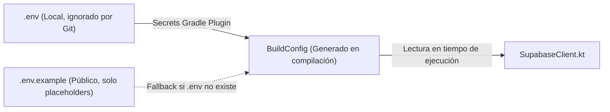

# Política de Seguridad y Manejo de Secretos — OficiosCerca

Este documento describe la arquitectura de seguridad, gestión de credenciales, autenticación, control de accesos y hallazgos técnicos identificados durante la auditoría de seguridad de la aplicación móvil **OficiosCerca**.

---

## 1. Gestión de Credenciales y Variables de Entorno

### 1.1 Inyección Segura mediante Secrets Gradle Plugin
La aplicación no almacena credenciales ni tokens sensibles en el código fuente de Kotlin (`.kt`) ni en recursos XML.

La arquitectura de inyección opera mediante el plugin **Secrets Gradle Plugin** (`com.google.android.libraries.mapsplatform.secrets-gradle-plugin`), el cual:
1. Lee las variables declaradas en el archivo local `.env`.
2. Las inyecta de forma segura en tiempo de compilación dentro de la clase autogenerada `BuildConfig` (`BuildConfig.SUPABASE_URL`, `BuildConfig.SUPABASE_PUBLISHABLE_KEY`).
3. Toma como respaldo seguro el archivo plantilla `.env.example` en caso de que `.env` no exista, permitiendo que la compilación continúe con valores de demostración sin romper el entorno de desarrollo.



### 1.2 Regla de Oro: Exclusión en `.gitignore`
El archivo `.env` que contiene las claves reales del proyecto **jamás debe subirse al control de versiones**. Se encuentra explícitamente listado en el archivo `.gitignore` del proyecto. Solo `.env.example` (que contiene únicamente nombres de variables y valores de muestra) forma parte del repositorio.

---

## 2. Autenticación y Gestión de Sesiones

- **Mecanismo de Autenticación:** Se utiliza **Supabase Auth (GoTrue)** mediante el protocolo estándar de correo electrónico y contraseña.
- **Tokens de Sesión (JWT):** Tras el inicio de sesión exitoso, Supabase emite un token de acceso JWT firmado criptográficamente y un token de actualización (refresh token).
- **Cierre Seguro de Sesión:** El método `AuthService.signOut()` ejecuta una revocación global (`SignOutScope.GLOBAL`) de la sesión activa en el servidor. Si por fallas de conectividad la llamada remota falla, implementa un fallback a revocación local (`SignOutScope.LOCAL`) para garantizar que la memoria del dispositivo no conserve tokens válidos.
- **Limpieza de Estado en Memoria:** Al invocar `logout()` en `OficiosViewModel`, se purgan todos los estados reactivos, listas de solicitudes, identificadores en caché y la pila de navegación, retornando al usuario a la pantalla de login.

---

## 3. Modelo de Control de Acceso Basado en Roles (RBAC)

El sistema opera con dos roles mutuamente excluyentes definidos en el enum `UserRole`:
- `CLIENT` (`"client"` en base de datos)
- `WORKER` (`"worker"` en base de datos)

### Reglas de Autorización en el Cliente:
1. **Separación de Flujos:** Un usuario con rol de cliente solo tiene acceso a las pantallas y flujos de búsqueda, contratación, seguimiento de sus propios pedidos y calificación (`Screen.Client*`). Un usuario con rol de trabajador solo accede a su panel de control, recepción de solicitudes de su oficio y actualización de estados (`Screen.Worker*`).
2. **Consistencia Estricta de Roles:** Durante la carga del perfil (`loadCurrentUserProfile`), si el campo `role` contiene un valor no autorizado o desconocido, el sistema bloquea el acceso, cierra la sesión e instruye al usuario a contactar a soporte.
3. **Normalización de Roles Heredados:** El repositorio maneja con seguridad variantes históricas de registros, normalizando `'PROFESSIONAL'` a `UserRole.WORKER` de forma controlada.

---

## 4. Políticas de Seguridad a Nivel de Fila (Supabase RLS)

En una arquitectura con backend como servicio (BaaS) como Supabase, **la seguridad no debe depender únicamente de la aplicación móvil**, ya que cualquier cliente podría interactuar con la API REST de PostgREST.

Por ello, se recomienda garantizar las siguientes políticas **Row Level Security (RLS)** en PostgreSQL:

### 4.1 Tabla `profiles`
```sql
-- Permitir que cualquier usuario autenticado lea perfiles (necesario para ver nombres de profesionales y clientes)
CREATE POLICY "Lectura pública de perfiles" ON profiles
FOR SELECT USING (true);

-- Permitir que cada usuario solo modifique su propio perfil
CREATE POLICY "Modificación de perfil propio" ON profiles
FOR UPDATE USING (auth.uid() = id);

-- Permitir que cada usuario inserte su propio perfil durante el registro
CREATE POLICY "Inserción de perfil propio" ON profiles
FOR INSERT WITH CHECK (auth.uid() = id);
```

### 4.2 Tabla `service_requests`
```sql
-- Un cliente solo puede ver sus solicitudes, y un profesional solo las dirigidas a él
CREATE POLICY "Acceso a solicitudes involucradas" ON service_requests
FOR SELECT USING (
    auth.uid() = client_id OR 
    auth.uid() IN (SELECT profile_id FROM professionals WHERE id = professional_id)
);

-- Solo el cliente autenticado puede crear una solicitud a su nombre
CREATE POLICY "Creación de solicitud por cliente" ON service_requests
FOR INSERT WITH CHECK (auth.uid() = client_id);

-- Solo las partes autorizadas pueden actualizar el estado de la solicitud
CREATE POLICY "Actualización de estado por las partes" ON service_requests
FOR UPDATE USING (
    auth.uid() = client_id OR 
    auth.uid() IN (SELECT profile_id FROM professionals WHERE id = professional_id)
);
```

### 4.3 Tabla `reviews`
```sql
-- Las reseñas son de lectura pública para construir la reputación del trabajador
CREATE POLICY "Lectura pública de reseñas" ON reviews
FOR SELECT USING (true);

-- Solo un cliente autenticado puede registrar una reseña de un servicio completado a su nombre
CREATE POLICY "Inserción de reseña por cliente del servicio" ON reviews
FOR INSERT WITH CHECK (auth.uid() = client_id);
```

---

## 5. Auditoría de Seguridad Realizada al Código

Durante el análisis del código fuente se identificaron los siguientes aspectos técnicos y recomendaciones:

### Hallazgo 1: ID de Usuario de Prueba para Diagnóstico en Código
- **Archivo:** `app/src/main/java/com/example/service/OficiosRepository.kt` (Líneas 339-351).
- **Detalle:** Existe una consulta de prueba explícita que busca el perfil con ID `"eccd83ba-fb44-4e57-a146-4a758c9b7e29"` ("Carlos Prueba") en los registros de diagnóstico.
- **Nivel de Riesgo:** **Bajo / Informativo**. No expone claves privadas ni contraseñas (es un UUID de prueba en base de datos), pero corresponde a código de depuración temporal.
- **Recomendación para Producción:** Eliminar el bloque de diagnóstico antes del lanzamiento comercial o empaquetado para Google Play.

### Hallazgo 2: UUIDs de Categorías Predefinidas
- **Archivos:** `app/src/main/java/com/example/ui/auth/AuthScreens.kt` y `OficiosRepository.kt`.
- **Detalle:** El código contiene UUIDs predefinidos para las 6 categorías oficiales (ej. `330571e3-9665-4088-92da-0f2c98d7f8f5` para Plomería).
- **Nivel de Riesgo:** **Informativo / Ninguno**. Son identificadores públicos del catálogo maestro de la base de datos necesarios para mapear oficios sin requerir una consulta previa.

### Hallazgo 3: Referencias a Keystores de Firma
- **Archivo:** `app/build.gradle.kts`.
- **Detalle:** Se definen configuraciones de firma para `debug.keystore` y `my-upload-key.jks`.
- **Estado de la Auditoría:** Ninguno de los dos archivos de llaves (`.keystore` o `.jks`) está presente en el repositorio. La contraseña por defecto declarada en `build.gradle.kts` para debug (`"android"`) es el estándar público de depuración de Google Android Studio.
- **Recomendación para Producción:** Mantener `my-upload-key.jks` fuera del repositorio y alimentar las variables `STORE_PASSWORD` y `KEY_PASSWORD` mediante variables de entorno secretas del servidor CI/CD (GitHub Secrets).

---

## 6. Lista de Verificación Previa a la Publicación en GitHub

Antes de subir el repositorio a un servidor público o repositorio compartido de Git, confirma los siguientes puntos:

- [x] No existen archivos `.env` reales presentes en el árbol de archivos.
- [x] `.env` está registrado en `.gitignore`.
- [x] No existen archivos de llaves de firma privada (`*.jks`, `*.keystore`) en el repositorio.
- [x] Las credenciales en `.env.example` son valores plantilla ficticios (`YOUR_SUPABASE_URL`, etc.).
- [x] No hay contraseñas de usuarios ni tokens JWT guardados en archivos de código o logs.
- [x] La carpeta de compilación `build/` y archivos `.gradle/` están excluidos en `.gitignore`.

---

[← Volver a Guía de Contribución](CONTRIBUTING.md) | [Ver Modelo de Base de Datos →](DATABASE.md)
